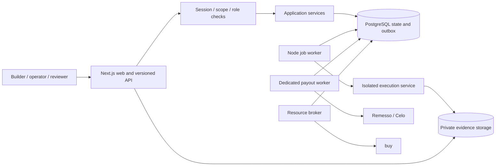

# Application architecture

Decision: VAL-05 / D013. Accepted for the internal alpha on 2026-10-27. This selects implementation tools; it does not close independent verification, paid-resource, or production release gates.

## Shape and stack

Build a modular monolith with two processes: a Next.js web/API process and a Node worker. Keep one npm package and explicit module boundaries until separate deployment or ownership justifies a workspace split. Existing `spikes/` remain reproducible experiments, not production adapters.

| Concern | Choice | Reason and boundary |
| --- | --- | --- |
| Runtime and language | Node 24, strict TypeScript; exact dependency pins | Shared types across API, worker, and UI; compatible with the proven SDK and browser tooling |
| Web and API | Next.js 16.4.3 App Router, React 19.3.1, Node route handlers | One application for builder/reviewer screens and versioned operator HTTP API; business rules live outside route handlers |
| UI | Semantic React, CSS variables and component styles, locally bundled fonts | Accessible, responsive product UI without a component framework dependency; design context is recorded separately |
| Database | PostgreSQL 18.6, `pg` 8.23.1, reviewed SQL migrations | Explicit transactions, row locks, constraints, and numeric money values; no ORM hiding the financial transaction boundaries |
| Jobs/outbox | PostgreSQL outbox, short claim transactions with `FOR UPDATE SKIP LOCKED`, expiring leases and fencing tokens | Acceptance/payable/job writes can share one database transaction. No additional queue service in the alpha |
| Human authentication | Better Auth with PostgreSQL sessions, invite-only accounts | Use maintained session/auth primitives; workspace roles and eligibility remain application checks. Implement in ALPHA-02, not a demo bypass |
| Operator authentication | Hashed, scoped, revocable API credentials; wallet ownership challenge verified with viem | Agent access and payout address control are separate; wallet signatures do not establish independent ownership |
| Private artifacts | AWS S3, private buckets/prefixes, expiring scoped URLs, hashes and retention metadata in PostgreSQL | Store large evidence outside the database; only reviewed exports can become public |
| Deployment target | Render Docker web service and background worker, managed PostgreSQL via direct/session-capable connections | Containers preserve the runtime and allow separate process credentials. No account or infrastructure is provisioned by this decision |
| Execution isolation | Separate Linux runner host using gVisor `runsc`, per-assignment containers, constrained egress proxy | Keep customer code and browser execution outside web/payment processes. Chromium compatibility and egress enforcement must pass ALPHA-05 before customer targets are enabled |
| Providers | Separate Remesso payout and buy resource adapters | Stable identities and durable recovery. No live money path exists in the initial scaffold |

PostgreSQL is preferred over SQLite for cross-worker claims/ledger transactions. SQL is preferred over an ORM initially because the difficult operations are explicit locking and accounting. A separate API framework and Redis queue would add deployment and consistency boundaries before they provide useful benefits. Fully serverless execution is unsuitable for long-lived browser work and signer coordination; the UI can still be moved later without changing domain services.

## Process boundaries

The diagram is the target design. ALPHA-01 supplies the web shell, database/migrations, smoke worker, and tooling. [ALPHA-02](ALPHA-02.md) adds real invited sessions, workspace authorization, authorized project/build records, and immutable draft terms. Payout, resource, runner, operator credentials, assignment/ledger, and upload capabilities remain unavailable until their owning tasks pass.

## Data and transactions

- Organize application code under `src/`: `app/` for HTTP/UI, `server/` for infrastructure/services, `domain/` for pure rules and types, and `demo/` for explicitly synthetic presentation data. `workers/` contains process entry points; `db/migrations/` contains append-only SQL; `scripts/` contains local/operator tooling.
- Use UUID record identities and UTC timestamps. Store financial amounts as `numeric(78,0)` constrained to unsigned token units and uint256 range; use `bigint` in TypeScript and decimal strings over JSON. Token/chain/decimals are explicit, never inferred from a label. Keep work state separate from payable/payment state.
- Workspace membership scopes every private record query. Reviewer access is explicit and audited. A demo route reads only fixture data and can never become an authenticated user or authorize a mutation.
- Claims lock the relevant shared funding allocation and campaign in a consistent order. They atomically validate active terms/lease/funding, reserve maximum liability, and insert the assignment. Later ALPHA-04 tests must prove two simultaneous last-slot claims cannot overspend.
- Final acceptance, immutable payable identity/recipient/amount, accounting reclassification, and outbox insertion commit together. Reclassification must not add a second liability. Policy loss blocks dispatch and new claims; accepted debt persists.
- Jobs are delivered at least once. Each handler must be idempotent. A claim obtains a fresh lease token; stale workers cannot acknowledge or write effects after lease expiry. External money handlers must reconcile their original operation before any retry, regardless of queue status.
- Remesso needs shared payment/remittance/invoice journals and signer coordination. Its PostgreSQL adapter is a candidate for ALPHA-08; do not reuse the spike's unlocked file stores. Session-level advisory locks require a direct/session-capable pool, not transaction-pooling middleware.
- Migration files carry checksums. A single advisory lock serializes migration runners; each migration and its registry entry commit together. Edited applied migrations fail closed. Web requests never auto-migrate.

## API and security boundary

Use `/api/v1/` for operator/business APIs when implemented, with structured error codes and request IDs. Mutations validate content, actor/scope/role, immutable terms, current attempt token, and idempotency identity in the application service. The MCP adapter will call these same services. Do not expose arbitrary SQL, shell commands, target fetchers, or payment methods to agents.

The first scaffold has only liveness/readiness endpoints and fixture exports. No public signup, customer-record read, campaign publication, artifact upload, or live-provider endpoint is enabled. Missing configuration fails explicitly; there is no fallback from failed database access to pretend production data.

Production web/worker/runner identities will have separate secrets and least-privilege database/storage permissions. Runners receive only an assignment-scoped manifest and short-lived test credentials, never wallet keys or database credentials. ALPHA-05 must validate DNS/redirect/internal-address/metadata restrictions, output sizes, deadlines, and clean teardown. gVisor is one part of this boundary, not proof that the entire system is safe.

## Local development and checks

The verified ALPHA-01 scaffold provides one isolated PostgreSQL Compose service bound to loopback, an ignored `.env` created from a safe template, explicit migration/smoke commands, `dev`, `build`, `start`, `worker`, type/lint/test commands, and CI. See [DEVELOPMENT.md](DEVELOPMENT.md) for commands and [ALPHA-01 evidence](evidence/ALPHA-01.json) for local outcomes. Local development credentials belong only to that project database. No existing PostgreSQL service or unrelated repository is modified.

Verification layers: pure domain/guard tests; migrations, job contention/restart/fencing against a fresh disposable PostgreSQL test database; production build; and desktop/mobile browser smoke tests. The initial worker handles only a database-local `system.ping` event, demonstrating persistence without creating a payment or external side effect.

Operational checks distinguish a live process from a ready database/schema. Logs use event names, IDs, and classified failures, excluding credentials, raw provider errors, signed transactions, and trace content. Deployment and database backups/restore drills are later gates, not implied by a working local build.

## Sources checked 2026-10-27

- [Next.js installation](https://nextjs.org/docs/app/getting-started/installation) and [self-hosting](https://nextjs.org/docs/app/guides/self-hosting): App Router, Node process, separate linting, container deployment. Package registry confirmed Next 16.4.3 / React 19.3.1 and Node compatibility.
- [PostgreSQL version policy](https://www.postgresql.org/support/versioning/), [locking](https://www.postgresql.org/docs/current/explicit-locking.html), and [SELECT locking clauses](https://www.postgresql.org/docs/current/sql-select.html): supported PostgreSQL 18.6 and queue/transaction primitives. Official image resolved to `sha256:10a5c69a83035ab5239f5620d708520e8b28f5aa1f2b20143e6024532edadfb5`.
- [node-postgres transactions](https://node-postgres.com/features/transactions): all statements of a transaction must use one checked-out client.
- [Better Auth installation](https://better-auth.com/docs/installation) and [database integration](https://better-auth.com/docs/concepts/database): database-backed authentication and schema management; production integration remains future work.
- [S3 presigned URLs](https://docs.aws.amazon.com/AmazonS3/latest/userguide/using-presigned-url.html): expiring access still requires explicit authorization and key/overwrite controls.
- [Render workers](https://render.com/docs/background-workers), [Docker deployment](https://render.com/docs/docker), and [gVisor](https://gvisor.dev/docs/): selected deployment/execution building blocks, not provisioned services or verified runner compatibility.

## Open gates

VAL-02 independent review and VAL-04 useful paid output remain open. ALPHA-02 must establish real sessions, workspace roles, and immutable project/terms ownership before business mutations. ALPHA-04/08 must prove ledger/outbox/signer concurrency. ALPHA-05 must prove runner isolation. Live provider funding, production credentials, deployment, public repository, and hackathon enrollment have not been performed.
